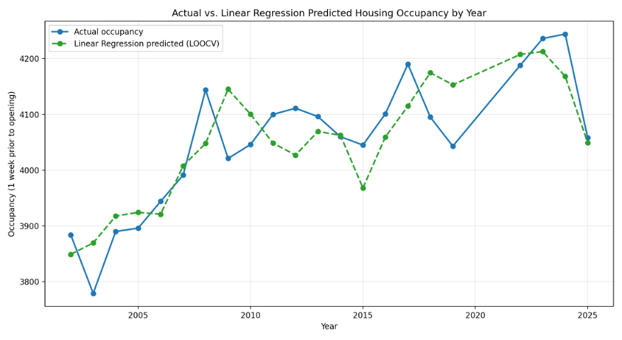

# University Housing Occupancy Forecasting

## Project Overview

**Objective:** Independently developed a Python-based forecasting tool within one month while working part-time to support university housing capacity and resource planning.

**Technologies:** Python, Jupyter Notebook, pandas, scikit-learn, Matplotlib

**Key Results:**
- Developed a tool that generates occupancy forecasts in approximately **5 minutes** once required inputs are available, compared with an existing process involving months of preparation and ongoing analysis.
- Predicted 2026 occupancy within **86 students (2.23% error)** of actual occupancy.
- Achieved **54.44 students MAE** and **1.32% MAPE** using expanding-window validation.

> **Confidentiality:** Institutional data and source code are withheld for confidentiality. My supervisors have authorized private demonstrations to prospective employers upon request.

## 1. Business Problem

The university's housing office requires occupancy forecasts months before fall move-in to plan housing capacity, staffing, and resources.

Its existing PowerSim-based forecasting process involves extensive preparation and ongoing monitoring of enrollment trends. This project aimed to streamline forecast generation using historical housing, enrollment, and demographic data.

## 2. Data & Methodology

### Data Sources

| Dataset | Description | Time Period |
|---------|-------------|-------------|
| University Housing Records | Fall occupancy one week before opening | 1996–2025 |
| University Enrollment Records | Incoming first-year and transfer enrollment | 2002–2026 |
| WICHE – Knocking at the College Door | State-level high school graduate counts and projections | 1996–2041 |

### Data Cleaning & Preparation

- **Data Quality:** Removed irrelevant records, investigated missing values, and excluded an entirely null column.
- **Data Standardization:** Converted text-formatted numerical values and percentages into appropriate numeric data types.
- **Missing Data:** Excluded historical observations with unavailable enrollment records.
- **Feature Screening:** Removed irrelevant projection indicators and a zero-variance COVID indicator.
- **Data Leakage Prevention:** Removed target-derived occupancy categories and measurements unavailable at the forecast date.
- **Anomaly Handling:** Excluded COVID-disrupted years (2020–2021) due to structural changes in housing occupancy.
- **Dataset Integration:** Combined three datasets by academic year and separated historical training data from the 2026 prediction inputs.

### Feature Engineering & Selection

- Examined historical occupancy trends and correlations to inform predictor selection.
- Engineered prior-year occupancy as a lagged feature and binary indicators for the 2024 FAFSA delay and 2025 confirmation fee removal.
- Selected six predictors representing incoming enrollment, historical occupancy, high school graduate counts, and policy disruptions.

The final modeling dataset contained **22 historical observations and six predictors**.

### Model Selection & Validation

Compared Linear Regression and Random Forest using **Leave-One-Out Cross-Validation (LOOCV)** to evaluate model performance on a limited dataset.

Selected Linear Regression based on its lower prediction errors and interpretability.

Further evaluated the selected model using **expanding-window validation**, which trains on earlier observations and predicts later years to better simulate real-world forecasting.

*LOOCV evaluated all 22 historical observations, while expanding-window validation evaluated the final seven. Because they use different test periods, their metrics are not directly comparable.*

## 3. Results

### Model Comparison — Leave-One-Out Cross-Validation

| Model | MAE (Students) | RMSE (Students) | MAPE | R² |
|-------|----------------|-----------------|------|-----|
| **Linear Regression** | **53.22** | **63.35** | **1.31%** | **0.704** |
| Random Forest | 69.60 | 82.10 | 1.71% | 0.504 |

Linear Regression outperformed Random Forest across all four evaluation metrics.

### Historical Forecasting Performance — Expanding-Window Validation

| Model | MAE (Students) | RMSE (Students) | MAPE |
|-------|----------------|-----------------|------|
| Linear Regression | 54.44 | 72.13 | 1.32% |

*Figure 1. Actual versus predicted housing occupancy using Linear Regression and Leave-One-Out Cross-Validation (LOOCV). COVID-disrupted years (2020–2021) were excluded.*

**Independent 2026 Forecast:** The model's prediction differed from actual occupancy by **86 students (2.23%)**, providing an additional evaluation against a previously unseen year.

### Forecasting Tool

The final deliverable is a Jupyter Notebook designed for university housing staff.

Users enter projected high school graduate counts, prior-year occupancy, incoming first-year and transfer enrollment estimates, and relevant policy indicators into a designated input section.

Running the notebook generates a fall housing occupancy forecast in approximately **5 minutes**, once the required inputs are available.

## 4. Limitations & Future Improvements

### Limitations

- **Limited Historical Data:** Only 22 observations were available, increasing overfitting risk and limiting the model's ability to learn complex relationships.
- **Historical Input Availability:** Historical validation used finalized enrollment counts, while the 2026 forecast used preliminary estimates. This mismatch may overstate expected real-world forecasting performance.
- **Structural Changes:** COVID-disrupted years were excluded, and the FAFSA delay and confirmation fee removal indicators each represent only one historical year, limiting generalizability.
- **Existing Method Comparison:** A direct accuracy comparison with PowerSim was not possible because historical forecasts and evaluation metrics were unavailable.
- **Multicollinearity:** Correlations among some predictors may make individual regression coefficients difficult to interpret.

### Future Improvements

- **Improve Validation:** Obtain historical preliminary enrollment estimates to better simulate real-world forecasting conditions.
- **Expand Predictors:** Evaluate housing capacity, application activity, and other relevant variables.
- **Monitor Performance:** Compare future predictions against actual occupancy and retrain annually as new data becomes available.
